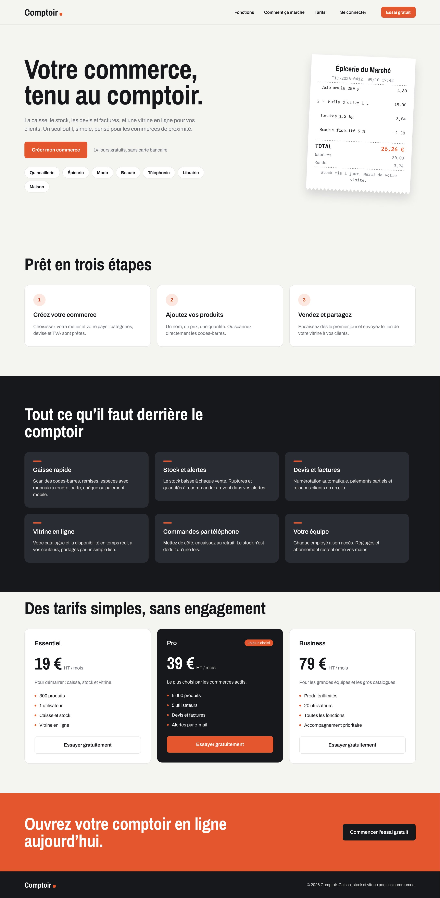
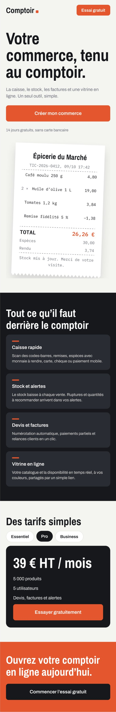
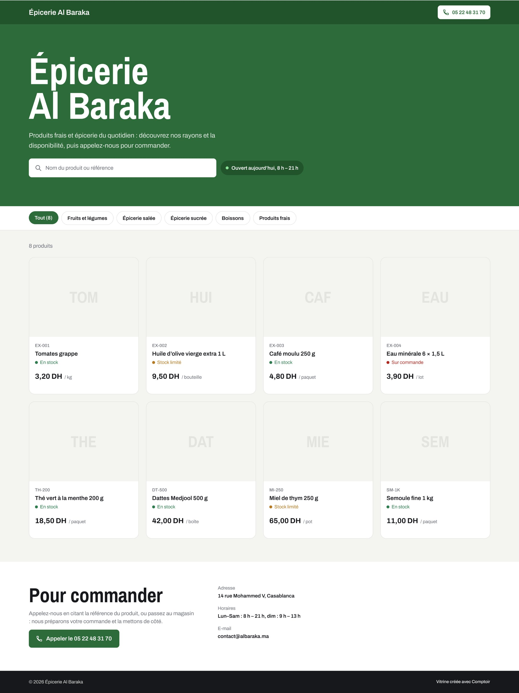
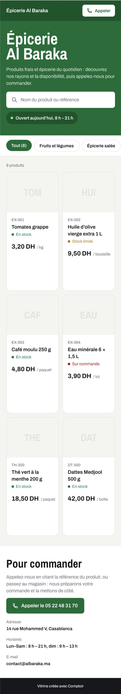

# Design de Comptoir

Fichier source dans Figma : **https://www.figma.com/design/76wfHUeIuxJcFzAcIjRSbr**

Ce dossier contient l'export de la maquette, pour la consulter sans compte Figma.

| Fichier | Contenu |
|---|---|
| `maquette-site-et-vitrine.png` | Export complet de la page « Site et vitrine » (4 écrans) |
| `ecrans/site-ordinateur.png` | Site de présentation, version ordinateur (1440 px) |
| `ecrans/site-telephone.png` | Site de présentation, version téléphone (390 px) |
| `ecrans/vitrine-ordinateur.png` | Vitrine d'un commerce (exemple : Épicerie Al Baraka), version ordinateur |
| `ecrans/vitrine-telephone.png` | Vitrine d'un commerce, version téléphone |
| `tokens.json` | Couleurs, espacements, arrondis et styles de texte du design |

## Aperçu

### Site de présentation

  
  

### Vitrine d'un commerce

  
  

## Règles du design

- **Couleurs** : encre `#17181C` pour le texte et les menus, fond `#F4F4F1`, cartes blanches bordées de `#E3E3DF`. Le vermillon `#E4572E` est réservé à l'action principale (Encaisser, Créer mon commerce). Les couleurs vert, orange, rouge et bleu servent uniquement à signaler un état : en stock, stock bas, retard ou rupture, information.
- **Polices** :
  - Archivo pour l'interface ;
  - **Archivo Narrow** pour les grands titres ;
  - **IBM Plex Mono** pour tout ce qui ressemble à un ticket de caisse.
- **Arrondis** : 8 px pour les boutons et champs, 12 px pour les cartes, 16 px pour les grandes tuiles, et des pastilles entièrement arrondies.
- **Élément signature** : le ticket de caisse au bord dentelé. Il sert d'image d'accueil du site et donne sa forme au panier de la caisse.
- **Vitrine** : la couleur vient du commerçant, réglée dans Réglages, Vitrine. Une teinte plus foncée est calculée automatiquement pour la barre du haut, et le texte passe en clair ou en foncé selon la luminosité de la couleur choisie.

Ces jetons sont repris dans le code, en tête de `public/app/app.css`, `public/assets/site.css` et `public/store/store.css`.

## Contenu du fichier Figma

1. **Fondations** : couleurs, typographie et 11 composants :
   - bouton, pastille, badge ;
   - indicateur chiffré, tâche « À faire » ;
   - tuile de caisse, carte produit (standard et compacte), ligne de ticket ;
   - champ de saisie, élément de menu, barre de navigation mobile.
2. **Site et vitrine** : les 4 écrans exportés ici.
3. **Espace commerçant et console** : à dessiner. Prévu : accueil, caisse, encaissement, fiche produit et vue d'ensemble de la console, en ordinateur et téléphone.

## Correspondance avec le site

Le site en ligne suit l'ordre des sections de la maquette : accroche, « Prêt en trois étapes », « Tout ce qu'il faut derrière le comptoir », tarifs, questions fréquentes, appel final.
